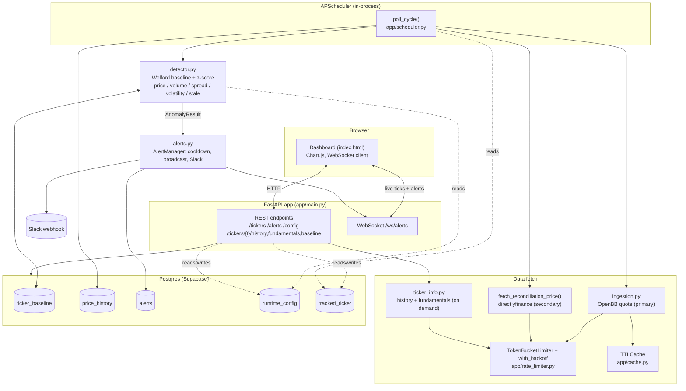

# Market Anomaly Alerts

A Python backend that polls market data (via [OpenBB](https://openbb.co/)) and detects
five independent kinds of anomaly against a per-ticker rolling baseline - price moves,
volume spikes, bid/ask spread widening, tick-to-tick volatility clustering, and stale/halted
quotes - plus a separate price reconciliation check against a second, independently-fetched
reading of the same ticker. Pushes alerts out over WebSocket and Slack, with a live
dashboard to watch it happen. Clicking a ticker opens a detail view (price chart with
selectable range, dividends, next earnings); clicking an alert opens the actual context
that triggered it (signals, baseline stats at the time, a nearby price chart); alert
thresholds are adjustable live from a settings panel; and the tracked
ticker set itself (1-5 tickers) is editable from the dashboard, with each addition validated
against the real data pipeline before being accepted.
Built as a practice project standing in for Bloomberg-style market data API experience,
with a deliberate focus on the mechanics that come up around any rate-limited external
API: throttling, backoff, caching, scalability, and cost tradeoffs.

**Live**: https://market-anomaly-alerts.onrender.com (free tier: polls only during NYSE
hours, and the first visit after a quiet spell can take about a minute to wake up - see
[Deployment](#deployment)).

## Architecture



Solid arrows are the live poll → detect → alert path; dashed arrows are the runtime-config
reads/writes that let thresholds and the tracked-ticker set change without a redeploy.

## Design decisions

- **Polling, not push.** Free OpenBB providers don't offer webhooks, and different data
  types warrant different intervals (equities every few minutes during market hours;
  macro data far less often) - tiering poll frequency by data type avoids wasting calls
  on data that hasn't changed.
- **Throttling via a shared token bucket** (`app/rate_limiter.py`), sized below the
  provider's documented cap rather than at it, so a burst of tickers in one poll cycle
  can't trip a 429. Backoff on failure is exponential with jitter.
- **Short-TTL caching** (`app/cache.py`), on the order of seconds. Anomaly detection
  needs fresh data, so this isn't "cache aggressively" - it just collapses duplicate
  fetches for the same ticker within one cycle.
- **Incremental baseline, not full-history rescans.** `TickerBaseline` maintains a
  running mean/stddev per ticker via Welford's algorithm, so each anomaly check is O(1)
  against stored aggregates instead of scanning `price_history`.
- **Debounced alerts.** A per-ticker cooldown (default 30 min) means a ticker that stays
  anomalous for many consecutive polls fires one alert, not one per cycle.
- **In-process WebSocket broadcast for the MVP.** `AlertManager` holds connections in a
  set on a single process. That's a known limit imposed by free tier: scaling to multiple
  instances would mean moving broadcast to Redis pub/sub (or similar) so alerts fan out across
  processes instead of only to clients connected to whichever instance polled the hit.
  Naming this limitation is deliberate - it's the honest answer to "how would this
  scale."
- **Rule-based detection (z-score).** Keeps the MVP explainable. Swapping in a
  model later is a natural extension.
- **Five signals tracked as independent series, one shared sample count** (price, volume,
  bid/ask spread, tick-to-tick delta magnitude, and a stale-quote counter). A ticker can be
  flagged for any combination - surfaced separately in the alert message (e.g.
  `"price+volume"`) rather than collapsed into one generic "anomaly" score.
  - **Spread** (`ask - bid`) is data we already fetch for the midpoint price calculation -
    tracking it as its own baseline cost nothing in new API calls, and a widening spread is
    a standard illiquidity/market-stress signal.
  - **Volatility clustering** is proxied as `abs(price - previous_price)` tracked as its own
    baseline - a ticker can have a perfectly normal-looking price while its *tick-to-tick
    movement magnitude* has shifted regime, which a price z-score alone can't see.
  - **Stale/halted detection** flags when price and volume are both unchanged for several
    consecutive polls - the same instinct as the daily-bar-vs-live-quote bug found earlier
    in this project, now automated instead of found by hand.
- **Price reconciliation as a separate check, not another baseline signal.** Cross-checks
  the primary OpenBB quote against a second reading fetched directly via `yfinance`
  (bypassing OpenBB's wrapper). Worth being honest about what this proves: both
  ultimately trace back to Yahoo Finance, so it's nreot two unrelated vendors - but it's a
  genuinely different code path/endpoint, and a large discrepancy is still a legitimate
  signal (stale cache, a bad read, a provider-side data issue). Uses its own cooldown key
  (`{ticker}:reconciliation`) so it never competes with or gets suppressed by a
  price/volume/spread/volatility alert on the same ticker.
- **Alert context is captured at trigger time, not reconstructed later.** The `Alert` row
  stores a JSON snapshot (which signals fired, the baseline mean/stddev at that moment) at
  the exact point in `scheduler.py` where the alert already fires - everything needed is
  already computed right there. The alternative (showing today's baseline when someone
  later opens an old alert) would be quietly wrong, since the baseline keeps evolving.
- **Alert thresholds live in Postgres (`RuntimeConfig`), not just `.env`.** Once that
  singleton row exists, it's the permanent source of truth - a later env var change has no
  effect. That's intentional: it's what makes the settings panel able to change real
  alerting behavior without a restart. Seeded once in the FastAPI `lifespan`, before any
  request is accepted, specifically so two concurrent first-requests can't race to insert it.
- **Ticker/alert detail views are modals, not separate pages** - keeps the existing
  WebSocket connection alive rather than re-establishing it on navigation. Charting is
  Chart.js via CDN (a real external dependency, a deliberate tradeoff for a working
  interactive chart in a few lines instead of hand-rolling SVG rendering).
- **A manual test-trigger endpoint** (`POST /debug/test-alert/{ticker}?kind=price|volume|spread|volatility`)
  fires a real alert - through the same storage/broadcast/Slack path as a genuine
  detection - using a synthetic value computed against the current baseline. It's
  read-only against the baseline itself, so demoing the alert path doesn't skew real
  stats with fake data. ("stale" isn't synthesizable as a single value - it's a multi-poll
  state, exercised only by the real poll cycle.) Exists because waiting on real 3-sigma
  market moves to demo the
  system isn't practical.

## Setup

```bash
python -m venv .venv
.venv\Scripts\activate
pip install -r requirements.txt
cp .env.example .env
```

Create a local Postgres database matching `DATABASE_URL` in `.env` (or point it at a
free Supabase/Neon instance). Tables are created automatically on startup.

## Run

```bash
uvicorn app.main:app --reload
```

Polls are skipped outside NYSE regular hours. To see live ticks while developing in the
evening or on a weekend, set `MARKET_HOURS_ONLY=false` in `.env`.

- `GET /` - live dashboard (real-time prices, z-scores, alert feed, test-trigger buttons)
- `GET /tickers` - tracked tickers and poll interval
- `POST /tickers/{ticker}` - add a tracked ticker (max 5, auth required); validates by
  actually calling the live ingestion path before persisting, not just checking format
- `DELETE /tickers/{ticker}` - remove a tracked ticker (min 1, auth required)
- `GET /alerts` - recent alerts
- `GET /alerts/{id}` - a single alert's full context (signals/baseline snapshot at trigger
  time) plus a nearby slice of `price_history` for a context chart
- `GET /tickers/{ticker}/baseline` - current rolling mean/stddev for a ticker
- `GET /tickers/{ticker}/history?range=1D|1W|1M|3M|1Y` - OHLC price series for the ticker
  detail chart
- `GET /tickers/{ticker}/fundamentals` - recent dividends + next earnings date/estimate
- `GET /config` - current alert thresholds
- `POST /config` - update one or more thresholds (auth required, same as test-alert)
- `POST /debug/test-alert/{ticker}?kind=price|volume|spread|volatility` - demo/testing
  only, see above
- `WS /ws/alerts` - live price ticks + alert stream (what the dashboard subscribes to)

## Notes

- Default tracked tickers and thresholds live in `.env` - see `.env.example`.
- **Cloud hosts can't always reach Yahoo's quote endpoint.** On Render it returns "Results
  not found" for every symbol, while the chart endpoint still works. When the quote fails,
  `_fetch_price_blocking` falls back to yfinance's `fast_info`, which is built from chart
  data (source `yfinance-chart`). Chart bars have no bid/ask, so the spread reads 0 and the spread signal
  stays quiet while the fallback is in use; price, volume, volatility and stale detection
  all still work.
- Ingestion uses `obb.equity.price.quote`, not `historical()` - historical() defaults to
  daily bars, which silently never shows price movement when polled every few minutes.
  OpenBB's Python interface has shifted across versions; verify against `obb.coverage` /
  the installed package's docs if this call doesn't match.
- `openbb` is imported at module load in `app/ingestion.py`, not deferred into the
  function that runs via `asyncio.to_thread` - OpenBB's first import registers a SIGTERM
  handler, which Linux only allows from the main thread (Windows is lenient about this,
  so it can look fine locally and fail silently, every single poll, once deployed).
- Slack alerts are optional - leave `SLACK_WEBHOOK_URL` blank to skip them.
- **Viewing is public; changing things takes the admin token.** Every endpoint that
  changes alerting behavior or sends a Slack message (adding or removing tickers,
  `POST /config`, `/debug/test-alert`) requires `X-Debug-Token` to match `DEBUG_TOKEN`,
  checked in one dependency (`require_admin_token` in `app/main.py`) with a
  constant-time comparison. It fails closed: unset means every admin request is
  refused. The token is never sent to the browser. The dashboard's "Unlock admin" link
  asks for it, checks it against `GET /admin/check`, and keeps it in the visitor's
  localStorage. A test enumerates every mutating route, so a new one can't ship without
  the check. It's one shared secret, not user accounts, which fits a single-operator
  demo.
- No migration tool (Alembic, etc.) - schema changes to existing tables need a manual
  `ALTER TABLE`, since `Base.metadata.create_all()` only creates missing tables, it
  doesn't alter existing ones.

## Deployment

Runs entirely on free tiers: a [Render](https://render.com) web service (configured in
`render.yaml`) and a [Neon](https://neon.com) Postgres database, both in AWS us-east-1.
Free tiers come with two constraints that shaped the design:

- **Neon's free plan allows 100 compute-hours a month, and its compute only sleeps after
  5 idle minutes.** Polling every 5 minutes around the clock would keep it awake
  permanently and use up the allowance in about two weeks. So `poll_cycle` returns
  before touching the database whenever the market is closed (`app/market_hours.py`:
  weekdays 9:30 AM - 4:00 PM New York time, NYSE holidays excluded). That brings usage
  down to roughly 145 hours a month. It also stops false "stale" alerts on holidays,
  when the price sits flat with zero volume.
- **Render's free web services sleep after 15 minutes without traffic,** and a sleeping
  process can't run its scheduler. A scheduled GitHub Actions workflow
  (`.github/workflows/keep-alive.yml`) pings `GET /health` every 5 minutes through the
  trading day. `/health` doesn't touch the database, so pings outside market hours keep
  the app up without waking Postgres.

The poll scheduler runs inside the web process, so the app runs as exactly one process
(`startCommand` in `render.yaml`). Adding workers would mean adding schedulers, each
polling every ticker.

To deploy your own copy: create a Neon project, then in Render choose New > Blueprint,
pick this repo, and paste the Neon connection string into `DATABASE_URL`. Finally set
the keep-alive's target with `gh variable set APP_URL --body "https://<service>.onrender.com"`.

## Ideal next steps

- Batch multi-symbol requests where the provider supports it, and move polling from a
  single loop to a queue of per-ticker jobs pulled by multiple workers - the path to
  scaling from a handful of tickers to hundreds.
- Move alert broadcast to Redis pub/sub so it works across multiple app instances (two
  instances of this app polling the same DB independently, each with its own in-memory
  cooldown state, is a real and current limitation - not hypothetical).
- Pipe daily aggregates into Snowflake as a reporting layer.
- Adopt Alembic once schema changes need to happen without direct DB access.
